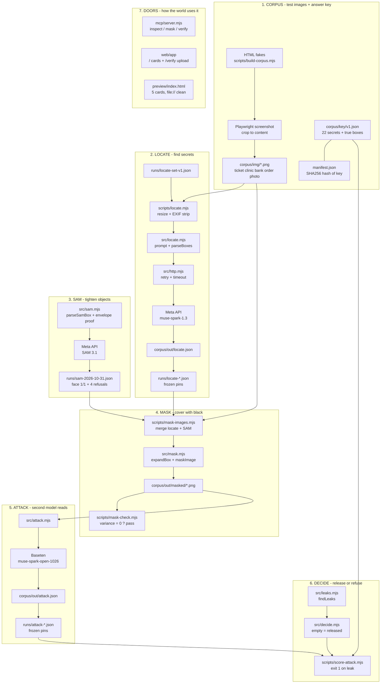

# Curtain — privacy gate that proves itself

Mask personal data in images, then have a second model try to read it.
Every number below has an id like E7. Each id is defined in `EVIDENCE.md`
(same folder): what it measures, in plain words, plus the exact command
that prints it. Run the command, compare your output to the value.

## The pipeline

```
corpus/img/*.png ──locate──▶ corpus/out/locate.json
runs/*.json (pinned) ──mask──▶ corpus/out/masked/*.png
masked ──attack (Baseten)──▶ corpus/out/attack.json
attack ──score──▶ leaks + verdict (released|refused)
```

Product code never reads `corpus/key/` (enforced by test). Only scorers do,
and they refuse to run on a tampered key (exit 2) or an empty run (exit 1).

## System map

Top to bottom: image in, verdict out.



## Zero-spend commands (judge path, no API keys)

| Command | Prints | Evidence |
|---|---|---|
| `npm run verify` | 70 checks, exit 0 | test suite |
| `npm run count:planted` | 22 items, 5 images | E1 |
| `npm run score` | recall 0.909 (20/22) | E2 |
| `npm run variance` | 3 runs: 0.864/0.909/0.773, every-run 0.727 | E7 |
| `node scripts/score-sam.mjs runs/sam-2026-10-31.json` | placement 1/1, refusal 4/4 | E4 |
| `node scripts/score-attack.mjs runs/attack-2026-10-31.json` | 0/22 leaks | E5 |
| `npm run cost` | $1.17 over 98 calls | E9 |
| `npm run verify:corpus` | one-line summary, exits 1 (mask 3/5 honest) | E6 |

Styled set (second synthetic corpus, 22 items):

| Command | Prints | Evidence |
|---|---|---|
| `node scripts/score-locate.mjs runs/locate-styled-2026-11-01.json corpus/key/v1-styled.json` | recall 0.773 (17/22) | E11 |
| `node scripts/score-attack.mjs runs/attack-styled-2026-11-01.json corpus/key/v1-styled.json` | 0/22 leaks | E13 |
| `npm run mask:sweep` | 16→0/5, 40→1/5, 64→4/5 | E12 |

Hard set (4 images, 10 items):

| Command | Prints | Evidence |
|---|---|---|
| `node scripts/score-locate.mjs runs/locate-hard-2026-11-01.json corpus/key/v1-hard.json` | recall 0.200 (2/10) | E14 |

## Doors onto the engine

Pick your path. No keys: run the zero-spend commands above — every number
reproduces from pinned files. Human trying it live: open the Next.js screen.
Agent calling it in a pipeline: use the MCP server.

- **MCP server** (`mcp/`, stdio): `inspect` / `mask` / `verify` tools for any
  agent. See `mcp/README.md`. Run: `npm run mcp` (needs env keys).
- **Next.js screen** (`web/`): `/` shows the 5 pinned cards, `/verify` runs a
  live attack→decide demo on your upload (mask-noop; full mask→attack→decide
  via MCP `verify` or API with boxes). Run: `cd web && npm install && npm run dev`.
- **Static fallback** (`preview/index.html`): frozen, works from `file://`.

## Live commands (spend credit, need `.env`)

Copy `.env.example` to `.env`, add keys. Then:

- `npm run locate` — ground boxes on the 5 v1 images
- `npm run mask-images` — apply pinned boxes to images
- `npm run attack` — Baseten attacker reads masked images
- `npm run locate:styled` — ground boxes on the styled set
- `npm run build-corpus` — rebuild synthetic images from HTML

## Pinned vs live

`runs/*.json` are committed. Scorers default to pinned files so a judge
reproduces every number with zero API calls. `corpus/out/` is gitignored —
live output lands there, never committed. If a re-run wobbles (temp 0 still
wobbles, see LIMITATIONS 7), the pinned file is the number.

## Re-pinning a manifest

The key is content-hashed. If `corpus/key/*.json` changes legitimately:

```
node -e "import('./src/manifest.mjs').then(m=>console.log(m.writeManifest('corpus/key/v1.json','corpus/key/manifest.json')))"
```

Key JSON files are never edited by hand. If a key legitimately changes,
its checksum file is regenerated with the command above, once, with a
commit message saying why. The key contents themselves are never touched.

## Limits

See `LIMITATIONS.md`. Headline: locate recall 0.773–0.909 (every-run 0.727),
mask 3/5, attacker 0/22, SAM finds objects not text, styled and hard sets
are worse than minimal, temp 0 is not deterministic.
